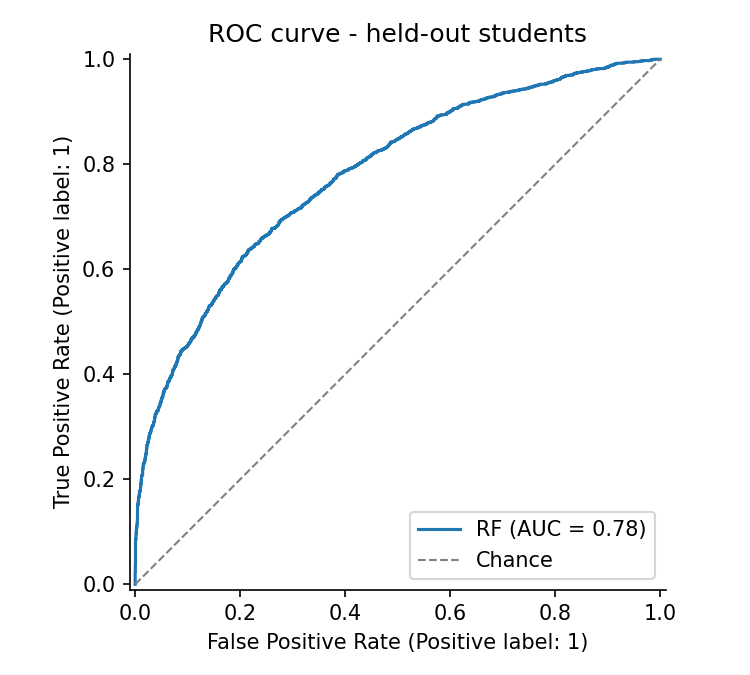
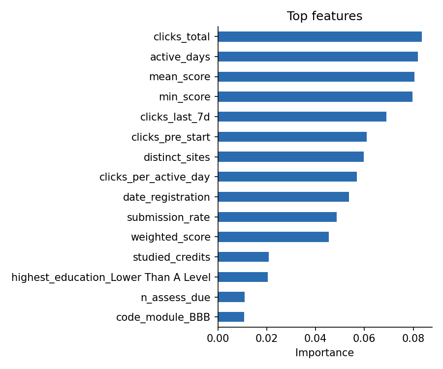
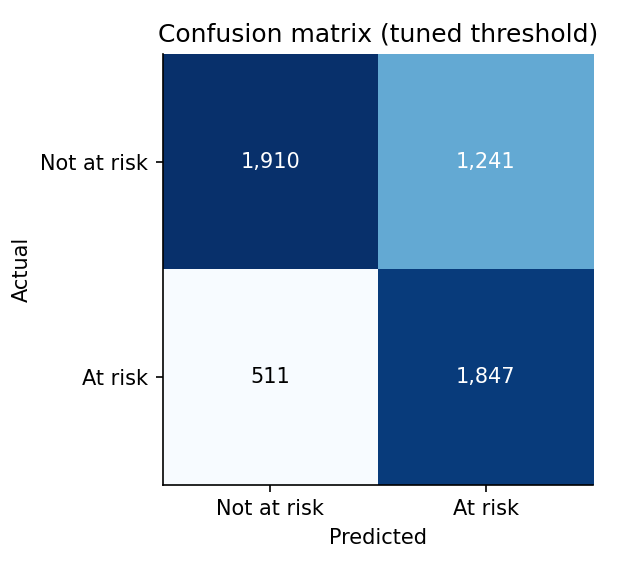

# oulad-early-risk

[](https://github.com/USERNAME/oulad-early-risk/actions/workflows/ci.yml)
[](https://github.com/USERNAME/oulad-early-risk/actions/workflows/release.yml)


**Leakage-resistant early academic risk prediction on the Open University Learning Analytics Dataset (OULAD).**

A small, tested Python package and command-line tool that predicts, **30 days after a module starts**,
which students are at risk of failing or withdrawing — while guaranteeing that the reported
performance is not inflated by data leakage. It is the software module of the master's research
*"Leakage-Resistant Early Academic Risk Prediction Using Explainable Machine Learning and
LLM-Based Explainability"* (Astana IT University, course *Applied Software Development Project*,
Assignment 3).

---

## Why this tool exists

Many published OULAD models report very high accuracy, but often because of two silent errors:

| Leakage type | What goes wrong | How this package prevents it | Verified by |
|---|---|---|---|
| **Temporal** | Features use clicks or scores from *after* the prediction day | Every behavioural record is filtered to `date <= cutoff_day`; exam rows (no date) are dropped | `test_future_records_do_not_change_features` |
| **Group** | The same student is in train *and* test (students take several modules) | `GroupShuffleSplit` by `id_student` + an automatic overlap audit that **fails the run** if any student is shared | `test_group_split_has_zero_student_overlap` |
| **Target** | Outcome-derived columns (`final_result`, `date_unregistration`) reach the model | Explicit `FORBIDDEN_FEATURES` list checked at runtime | `test_shapes_and_no_forbidden_columns` |
| **Preprocessing** | Imputation / scaling statistics computed on the full data | All preprocessing lives inside a scikit-learn `Pipeline` fitted on the training fold | design |
| **Threshold** | Decision threshold tuned on the test set | Threshold tuned on an inner, student-disjoint validation split | design |

On the real data a naive row-level split puts **848 students on both sides** of the split
(**15.5 %** of test rows leaked); the group split used here has **0**.

## Results on the full OULAD (day-30 cut-off)

27,466 enrolments of 24,787 students (5,127 enrolments that had already unregistered by day 30 are
excluded), 23 input features, 44.0 % at-risk rate; 80/20 student-disjoint split, seed 42.

| Model | ROC-AUC | F1 | Precision | Recall | Accuracy | Tuned threshold | Train ROC-AUC |
|---|---|---|---|---|---|---|---|
| Random Forest | 0.781 | 0.678 | 0.598 | 0.783 | 0.682 | 0.389 | 0.950 |
| XGBoost | **0.788** | **0.685** | **0.631** | 0.750 | **0.706** | 0.373 | 0.872 |
| Logistic Regression | 0.776 | 0.679 | 0.605 | 0.773 | 0.687 | 0.420 | 0.776 |

Full metrics, the leakage audit and figures are in [`results/`](results/). The most important
features are early VLE engagement (total clicks, active days) and early assessment scores.
The gap between train and test ROC-AUC for the Random Forest (0.95 vs 0.78) shows overfitting that
does not hurt held-out performance but is reported honestly rather than hidden.

<p align="center">  </p>

## Installation

```bash
git clone https://github.com/USERNAME/oulad-early-risk.git
cd oulad-early-risk
python -m venv .venv && source .venv/bin/activate   # Windows: .venv\Scripts\activate
pip install -e ".[dev,xgboost]"
```

Requires Python ≥ 3.10. Core dependencies: NumPy, pandas, scikit-learn, Matplotlib.
XGBoost is an optional extra.

## Getting the data

The dataset is **not** stored in the repository (≈ 450 MB). Download it from
[Kaggle](https://www.kaggle.com/datasets/anlgrbz/student-demographics-online-education-dataoulad)
or run:

```bash
bash scripts/download_data.sh        # downloads and unzips into data/raw/
```

The loader searches `data/raw/` recursively and case-insensitively for `studentInfo.csv`,
`studentRegistration.csv`, `assessments.csv`, `studentAssessment.csv` and `studentVle.csv`.
Only `studentInfo.csv` is mandatory; missing tables simply disable their features.

No data? Generate a synthetic dataset with the exact OULAD schema:

```bash
oulad-risk synth --out-dir data/synthetic
```

## Usage

```bash
# Train, evaluate and write metrics.json + figures
oulad-risk run --data-dir data/raw --out-dir reports/rf --model rf
oulad-risk run --data-dir data/raw --out-dir reports/xgb --model xgb --cutoff 30

# Compare a naive split with the group split
oulad-risk audit --data-dir data/raw

# Quality gate (used in CI): exit code 1 if ROC-AUC < 0.7
oulad-risk run --data-dir data/synthetic --model rf --min-auc 0.7
```

As a library:

```python
from oulad_risk import ExperimentConfig
from oulad_risk.data import load_tables
from oulad_risk.pipeline import run_experiment

tables = load_tables("data/raw")
results = run_experiment(tables, ExperimentConfig(model="xgb", cutoff_day=30), "reports/xgb")
print(results["metrics"]["test_tuned_threshold"])
```

## Project structure

```
oulad-early-risk/
├── src/oulad_risk/
│   ├── config.py      # constants, schemas, ExperimentConfig (validated, saved with results)
│   ├── data.py        # CSV loading + schema validation
│   ├── features.py    # leakage-safe 30-day feature engineering
│   ├── split.py       # group-aware split + overlap audit
│   ├── model.py       # sklearn Pipeline, threshold tuning, metrics, importances
│   ├── viz.py         # ROC, importance, confusion-matrix figures (headless)
│   ├── pipeline.py    # end-to-end experiment runner
│   ├── synthetic.py   # OULAD-shaped synthetic data for tests and CI
│   └── cli.py         # `oulad-risk` command
├── tests/             # 32 pytest tests, ~98 % coverage
├── results/           # reference results on the full OULAD
├── scripts/           # data download, issue creation helpers
├── .github/
│   ├── workflows/ci.yml        # lint -> test matrix -> smoke run -> build
│   ├── workflows/release.yml   # tag v*.*.* -> test -> build -> GitHub Release
│   ├── ISSUE_TEMPLATE/         # bug report / feature request
│   └── dependabot.yml
├── pyproject.toml     # packaging, dependencies, ruff/pytest/coverage config
└── Makefile           # make install | lint | test | smoke
```

## Technology choices (short)

| Choice | Reason |
|---|---|
| **Python 3.10+** | De-facto language of ML research; all required libraries are mature and free |
| **pandas** | Joins and group-by aggregation of relational OULAD tables (10.6 M VLE rows) |
| **scikit-learn** | `Pipeline` + `ColumnTransformer` make preprocessing leakage-free; `GroupShuffleSplit` gives student-disjoint splits |
| **XGBoost** (optional) | Strong gradient-boosting baseline on tabular data; kept optional to keep installation light |
| **Matplotlib (Agg)** | Headless figures that render identically on CI runners |
| **pytest + pytest-cov** | Simple fixtures, parametrisation, coverage gate in CI |
| **Ruff** | One fast tool for linting and formatting |
| **GitHub Actions** | CI/CD next to the code, free for public repositories, matrix builds |

The full justification is in the Assignment 3 report.

## Development

```bash
make install     # editable install with dev extras + pre-commit hooks
make lint        # ruff check + ruff format --check
make test        # pytest with coverage
make smoke       # synthetic data -> full run with the AUC quality gate
```

Workflow: create an issue → branch `feature/<name>` → commits following
[Conventional Commits](https://www.conventionalcommits.org/) → pull request → CI must be green → merge.
See [CONTRIBUTING.md](CONTRIBUTING.md).

## CI/CD

* **[`ci.yml`](.github/workflows/ci.yml)** runs on every push and pull request:
  1. **lint** — Ruff linting and format check;
  2. **test** — pytest on Ubuntu (Python 3.10, 3.11, 3.12), Windows and macOS; coverage must be ≥ 90 %;
  3. **smoke** — generates synthetic data, runs the full pipeline for RF and XGBoost with the
     `--min-auc 0.7` quality gate, runs the leakage audit and uploads the reports as an artifact;
  4. **build** — builds the wheel and sdist.
* **[`release.yml`](.github/workflows/release.yml)** (continuous delivery): pushing a tag such as
  `v0.1.0` re-runs the tests, builds the package and publishes a GitHub Release with the wheel attached.

## Data licence and citation

OULAD is published under CC-BY 4.0 by Kuzilek, Hlosta and Zdrahal,
*Open University Learning Analytics dataset*, Scientific Data 4, 170171 (2017).
To cite this software, see [`CITATION.cff`](CITATION.cff).

## License

Code: [MIT](LICENSE) © 2026 Nurtay Turlubekov.
